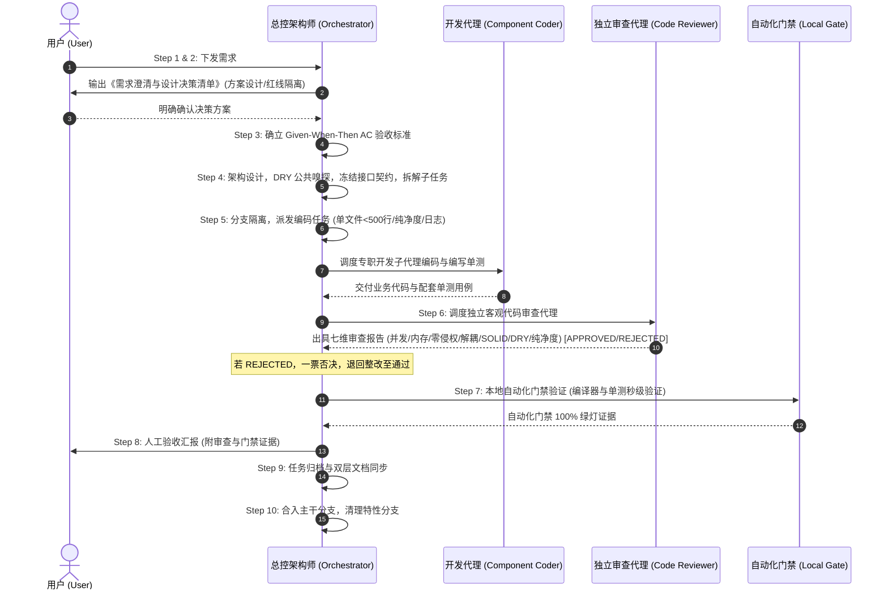

# 通用 AI 增强型商业级研发生命周期刚性执行法则

> **⚠️ 核心原则**：本项目采用标准化的 AI-Workflow 商业级研发治理流水线。无论在任何会话窗口、面对任何需求，AI 与开发者必须严格遵循本规范，严禁跳过任何环节，严禁自作主张。

---

## 🚫 开发者行为九大绝对红线 (Strict Redlines)

1. **【严禁未确认先编码】**：收到需求后，**第一步必须且只能向用户输出《需求澄清与设计决策清单》**。在用户明确确认之前，严禁调用写文件工具，严禁写任何一行业务代码。
2. **【严禁在主干主分支直接开发】**：用户确认需求后，必须通过分支隔离开发（如 `git checkout -b feature/<module>-<name>` 或 `fix/...`）。主干分支时刻保持 100% 可发版的干净状态。
3. **【严禁总控窗口直接修改业务源码】**：当前会话窗口定位为**流水线总控架构师 (Pipeline Orchestrator)**，负责统领 10 步状态机与子任务调度。业务代码与单测编写必须通过子代理调度机制派发给专职的开发子代理完成。
4. **【严禁自编自审，代码审查必须由独立 Agent 盲审 (七维一票否决制)】**：代码审查必须由专职只读审查代理执行客观盲审！审查未达 `APPROVED` 绿灯前，严禁进入自动化门禁合入环节。
5. **【严禁大需求单 Agent 囫囵吞枣与单一类臃肿 (S.O.L.I.D & DRY)】**：凡涉及 2 个以上模块的复杂需求，必须先冻结跨模块 Protocol/Interface 契约并拆解子任务。单一文件代码量严格受控（> 500 行警告，> 800 行强制拆解）。编码前必须执行公共实现嗅探，杜绝造重复轮子与上帝类。
6. **【严禁生产玩具 Demo 代码与商标侵权】**：严禁硬编码数据源与假数据。需求中提及的任何参考案例仅代表交互与体验参考，代码、类名、UI 文本或 Commit 中严禁出现任何第三方商业商标字样，必须使用中立的商业级命名。
7. **【严禁代码改完不更新架构与模块文档】**：代码与审查完成后，合入前必须同步更新系统架构、进度跟踪、详细设计与度量指标文档。未更新文档直接合入视为严重流水线事故。
8. **【严禁自检死板翻旧账，必须增量游标化并对齐用户反馈台账】**：自检复盘流程依托增量自检游标聚焦增量区间，且必须主动对齐指标文档中的「用户高频反馈与架构纠偏教训台账」，形成防复发闭环。
9. **【严禁测试代码侵入生产源码，关键链路必须强日志落盘】**：
   - **生产代码绝对纯净**：生产源码目录必须 100% 纯正，严禁出现任何测试/调试按钮、Mock 开关或调试桩代码；所有测试/演示辅助逻辑必须收敛至测试或演示目录。
   - **关键业务节点日志强落盘**：核心状态跃迁、数据传输、加解密/签名、存储读写与关键异常必须通过结构化日志落盘；严禁裸用吞没异常语法。

---

## 🔄 标准化十步流水线刚性协同状态机 (Orchestrator-Workers State Machine)

