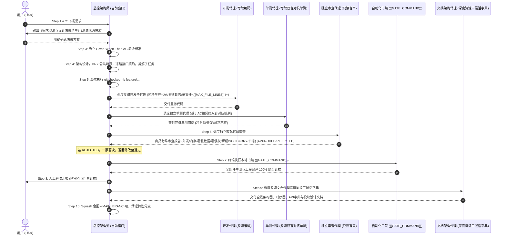

# {{PROJECT_NAME}} 研发规范与 AI 流水线刚性执行法则

> **⚠️ 核心警告**：本项目采用标准化的 AI-Workflow 商业级研发治理流水线。无论在任何会话窗口、面对任何需求，AI 必须将本规范视为**最高优先级系统铁律**，严禁跳过任何环节，严禁自作主张！

---

## 🚫 开发者行为九大绝对禁令 (Strict Redlines)

1. **【严禁未确认先编码】**：收到需求后，**第一步必须且只能向用户输出《需求澄清与设计决策清单》**。在用户明确回复确认之前，**严禁调用任何写文件工具，严禁写任何一行业务代码！**
2. **【严禁在 `{{MAIN_BRANCH}}` 主分支直接开发】**：用户确认需求后，**第一条终端命令必须是 `git checkout -b feature/<模块名>-<特性名>`**（或 `fix/...`）。`{{MAIN_BRANCH}}` 分支必须时刻保持 100% 可发版的干净状态。
3. **【严禁总控窗口直接修改业务源码】**：当前会话窗口定位为**流水线总控架构师 (Pipeline Orchestrator)**，负责统领 10 步状态机与子任务调度。**总控窗口严禁直接调用写入工具修改生产业务源码！** 业务代码编写必须通过子代理调度机制派发给专职开发子代理完成！
4. **【严禁自产自查，单测必须由独立测试代理双盲对抗验收 (模式 B)】**：严禁由 Coder 自编自测导致“确认偏差”！单测设计与编写必须由独立专职测试代理 `unit-tester` 基于 AC 验收标准与契约独立编写，专攻极端边界、异常容灾、并发竞态与冷启动恢复！
5. **【严禁自编自审，代码审查必须由独立 Agent 盲审 (七维一票否决制)】**：Step 6 代码审查必须派发专职只读审查代理 `code-reviewer`，执行客观盲审！审查未达 `APPROVED` 绿灯前，严禁进入 Step 7 门禁与 Step 10 合入！
6. **【严禁大需求单 Agent 囫囵吞枣与单一类臃肿 (S.O.L.I.D & DRY)】**：凡涉及 2 个以上组件的复杂需求，必须先在 Step 4 冻结跨组件 `Protocol/Interface` 契约并拆解子任务。**单一业务源文件代码量严格受控（> {{MAX_FILE_LINES}} 行警告，超过阈值强制拆解）**。编码前必须执行「公共实现嗅探 (DRY Audit)」，杜绝造重复轮子与上帝类。
7. **【严禁生产玩具 Demo 代码与商标侵权】**：本项目是商业级交付工程，严禁为了演示写死假数据、硬编码数据源。需求中提及的任何参考案例仅代表**交互与体验参考**，代码、类名、变量名、UI 文本或 Commit 中**严禁出现任何第三方商业商标字样**，必须使用中立规范命名。
8. **【严禁简略敷衍更新文档，必须由专职文档架构代理深度沉淀三层活字典】**：合入前**必须调度专职文档代理 `doc-architect` 同步更新架构全景、模块详细设计（含 Mermaid 时序图与契约字典）以及度量指标**！未深度沉淀文档直接合入视为严重流水线事故！
9. **【严禁测试代码侵入生产源码，关键链路必须强日志落盘】**：
   - **生产代码绝对纯净**：生产代码必须 100% 保持纯净，严禁出现任何测试/调试按钮、Mock 开关或调试桩代码；所有测试/演示辅助逻辑必须 100% 收敛至专门的测试或宿主演示目录。
   - **关键业务节点日志强落盘**：核心状态机流转、网络传输、加解密/签名、数据迁移与关键异常必须通过结构化日志持久化落盘；**严禁裸吞异常**，排查必须有迹可循。

---

## 🔄 标准化十步五角色协同状态机 (Orchestrator-Workers State Machine)

每次接到任何功能需求或 Bug 修复，总控 Agent 与专职 Subagents 必须严格执行以下十步：

---

## 👥 专职 Subagents 五角色职责矩阵

| Agent 标识 | 角色定位 | 工具权限 | 核心职责 |
| :--- | :--- | :--- | :--- |
| **Orchestrator (当前窗口)** | **流水线总控架构师** | 终端操作、调度 subagents | 统领 10 步状态机、与用户对齐方案、分支管理、接口契约冻结、门禁与合入。**严禁直接写业务代码**。 |
| **`component-coder`** | **专职组件开发代理** | 业务源码读写 | 窄上下文作业：遵循接口契约，执行 DRY 检索与单一职责（文件 < {{MAX_FILE_LINES}} 行），保证源码纯正生产级（0测试开关），关键节点日志强覆盖。 |
| **`unit-tester`** | **专职单元测试代理** | 测试源码读写，契约只读 | 模式 B 双盲对抗验收：基于 AC 标准与契约独立编写冷启动持久化、极端边界、故障注入与并发竞态测试，杜绝自产自查。 |
| **`code-reviewer`** | **独立代码与规范审查代理** | **只读权限**（严禁修改文件） | 客观盲审：检查并发安全、内存生命周期、无写死假数据、无第三方商标、协议解耦、**S.O.L.I.D & DRY**、**生产纯净度（无测试入侵）**、**日志强落盘与零裸吞异常**，执行一票否决制。 |
| **`doc-architect`** | **专职技术文档架构代理** | `DOCS/` 读写，代码只读 | 逆向提取代码实现，更新全景依赖 DAG、Mermaid 时序图、公开契约字典，沉淀模块级详细设计与教训台账，终结简略更新。 |

---

## 🔍 流水线指标可观测性与增量自检机制 (Pipeline Observability & Incremental Audit)

当用户提出 **“自检流程” / “复盘流水线” / “总结提升”** 等类似诉求时，总控 AI **必须且只能**调取 `DOCS/PIPELINE_METRICS.md` 中的历史数据与教训台账，按以下七维模型输出量化复盘报告：
1. **增量区间聚焦与对齐率**：基于增量游标统计本区间的澄清闭环率；
2. **分支隔离合规率**：特性分支使用率，`{{MAIN_BRANCH}}` 主分支直接污染必须为 0；
3. **架构拆解与单一职责合规率**：单文件是否控制在阈值以内，是否有上帝类或重复造轮子异味；
4. **生产代码纯净度**：生产源码中严禁测试辅助代码，所有测试辅助完全隔离；
5. **双盲测试对抗率与独立审查有效性**：单测是否由 `unit-tester` 双盲编写，审查是否由 `code-reviewer` 客观盲审并执行一票否决；
6. **文档架构深度与活字典达标率**：文档是否由 `doc-architect` 深度沉淀全景图、时序图与模块设计，拒绝形式主义简略更新；
7. **门禁健康度与改进建议**：`{{GATE_COMMAND}}` 自动化验证耗时与一次通过率。
