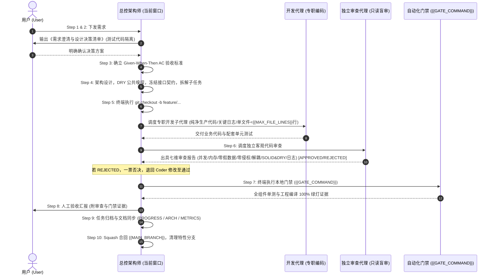

# {{PROJECT_NAME}} 研发规范与 AI 流水线刚性执行法则

> **⚠️ 核心警告**：本项目采用标准化的 AI-Workflow 商业级研发治理流水线。无论在任何会话窗口、面对任何需求，AI 必须将本规范视为**最高优先级系统铁律**，严禁跳过任何环节，严禁自作主张！

---

## 🚫 开发者行为九大绝对禁令 (Strict Redlines)

1. **【严禁未确认先编码】**：收到需求后，**第一步必须且只能向用户输出《需求澄清与设计决策清单》**。在用户明确回复确认之前，**严禁调用任何写文件工具，严禁写任何一行业务代码！**
2. **【严禁在 `{{MAIN_BRANCH}}` 主分支直接开发】**：用户确认需求后，**第一条终端命令必须是 `git checkout -b feature/<模块名>-<特性名>`**（或 `fix/...`）。`{{MAIN_BRANCH}}` 分支必须时刻保持 100% 可发版的干净状态。
3. **【严禁总控窗口直接修改业务源码】**：当前会话窗口定位为**流水线总控架构师 (Pipeline Orchestrator)**，负责统领 10 步状态机与子任务调度。**总控窗口严禁直接调用写入工具修改生产业务源码！** 业务代码与单测编写必须通过子代理调度机制派发给专职开发子代理完成！
4. **【严禁自编自审，代码审查必须由独立 Agent 盲审 (七维一票否决制)】**：Step 6 代码审查必须派发专职只读审查代理，执行客观盲审！审查未达 `APPROVED` 绿灯前，严禁进入 Step 7 门禁与 Step 10 合入！
5. **【严禁大需求单 Agent 囫囵吞枣与单一类臃肿 (S.O.L.I.D & DRY)】**：凡涉及 2 个以上组件的复杂需求，必须先在 Step 4 冻结跨组件 `Protocol/Interface` 契约并拆解子任务。**单一业务源文件代码量严格受控（> {{MAX_FILE_LINES}} 行警告，超过阈值强制拆解）**。编码前必须执行「公共实现嗅探 (DRY Audit)」，杜绝造重复轮子与上帝类。
6. **【严禁生产玩具 Demo 代码与商标侵权】**：本项目是商业级交付工程，严禁为了演示写死假数据、硬编码数据源。需求中提及的任何参考案例仅代表**交互与体验参考**，代码、类名、变量名、UI 文本或 Commit 中**严禁出现任何第三方商业商标字样**，必须使用中立规范命名。
7. **【严禁代码改完不更新架构与模块文档】**：代码与审查完成后，合入前**必须同步更新 `DOCS/PROGRESS.md`、`DOCS/ARCHITECTURE.md` 以及 `DOCS/PIPELINE_METRICS.md`**。未更新文档直接合入视为严重流水线事故！
8. **【严禁自检死板翻旧账，必须增量游标化并对齐用户反馈台账】**：自检流程严禁机械式全量扫描历史旧记录，必须依托「增量自检游标」聚焦增量区间，且**必须主动对齐 `DOCS/PIPELINE_METRICS.md` 中的「用户高频反馈与架构纠偏教训台账」**，形成防复发闭环。
9. **【严禁测试代码侵入生产源码，关键链路必须强日志落盘】**：
   - **生产代码绝对纯净**：生产代码必须 100% 保持纯净，严禁出现任何测试/调试按钮、Mock 开关或调试桩代码；所有测试/演示辅助逻辑必须 100% 收敛至专门的测试或宿主演示目录。
   - **关键业务节点日志强落盘**：核心状态机流转、网络传输、加解密/签名、数据迁移与关键异常必须通过结构化日志持久化落盘；**严禁裸吞异常**，排查必须有迹可循。

---

## 🔄 标准化十步流水线刚性协同状态机 (Orchestrator-Workers State Machine)

每次接到任何功能需求或 Bug 修复，总控 Agent 与专职 Subagents 必须严格执行以下十步：

---

## 🔍 流水线指标可观测性与增量自检机制 (Pipeline Observability & Incremental Audit)

当用户提出 **“自检流程” / “复盘流水线” / “总结提升”** 等类似诉求时，总控 AI **必须且只能**调取 `DOCS/PIPELINE_METRICS.md` 中的历史数据与教训台账，按以下七维模型输出量化复盘报告：
1. **增量区间聚焦与对齐率**：基于增量游标统计本区间的澄清闭环率；
2. **分支隔离合规率**：特性分支使用率，`{{MAIN_BRANCH}}` 主分支直接污染必须为 0；
3. **架构拆解与单一职责合规率**：单文件是否控制在阈值以内，是否有上帝类或重复造轮子异味；
4. **生产代码纯净度**：生产源码中严禁测试辅助代码，所有测试辅助完全隔离；
5. **用户高频反馈闭环率**：主动比对教训台账，历史纠偏点 100% 阻断复发；
6. **独立审查有效性**：Step 6 是否由专职独立审查代理进行七维盲审，是否发挥一票否决权；
7. **门禁健康度与改进建议**：`{{GATE_COMMAND}}` 自动化验证耗时与一次通过率。
