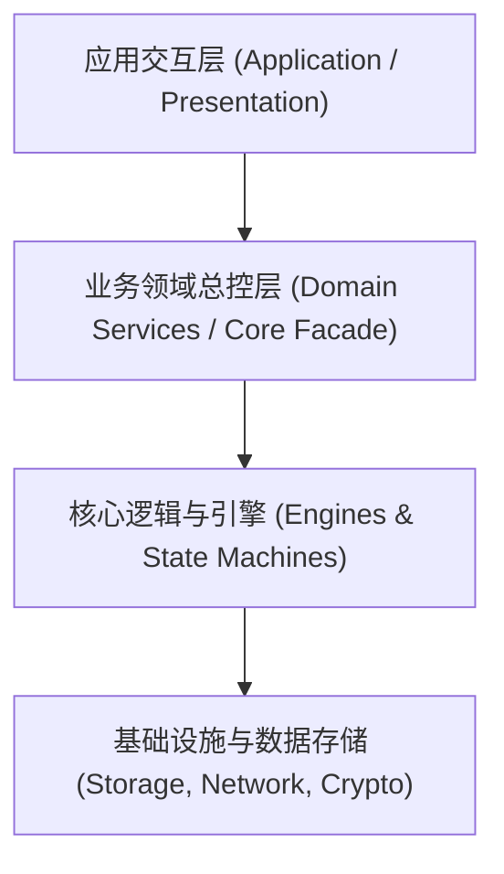

# {{PROJECT_NAME}} 系统架构与工程设计规范

## 1. 架构定位与核心原则 (Architecture Principles)

### 1.1 系统定位
本项目定位为高可用、高性能的商业级工程。核心目标是保证高吞吐、高稳定性、可维护性与可测性。

### 1.2 模块组织原则
所有业务能力必须按**高内聚、低耦合的独立模块**进行组织：
- **单向依赖原则 (DAG)**：模块间依赖必须为有向无环图，严禁循环依赖或跨层反向调用；
- **面向契约编程 (Interface/Protocol-First)**：模块间通信必须通过公开接口/协议抽象，杜绝强耦合；
- **独立可测**：每个业务模块必须配有独立的单元测试覆盖。

---

## 2. 模块分层结构图 (Architecture Overview)

---

## 3. 模块职责清单

| 模块名称 | 职责定位 | 核心依赖 | 公开契约 / 协议 |
| :--- | :--- | :--- | :--- |
| `CoreModels` | 核心领域模型与实体定义 | 无外部依赖 | 实体、枚举、基础错误定义 |
| `DataStorage` | 本地持久化与缓存管理 | 底层数据库引擎 | StorageProtocol |
| `Transport` | 网络通信与数据传输 | 系统网络栈 | TransportProtocol |
| `DomainCore` | 核心业务编排与聚合入口 | Storage, Transport | DomainServiceProtocol |

---

## 4. 架构变更记录 (RFC History)
- **v1.0.0**: 初始架构确立与模块解耦。
