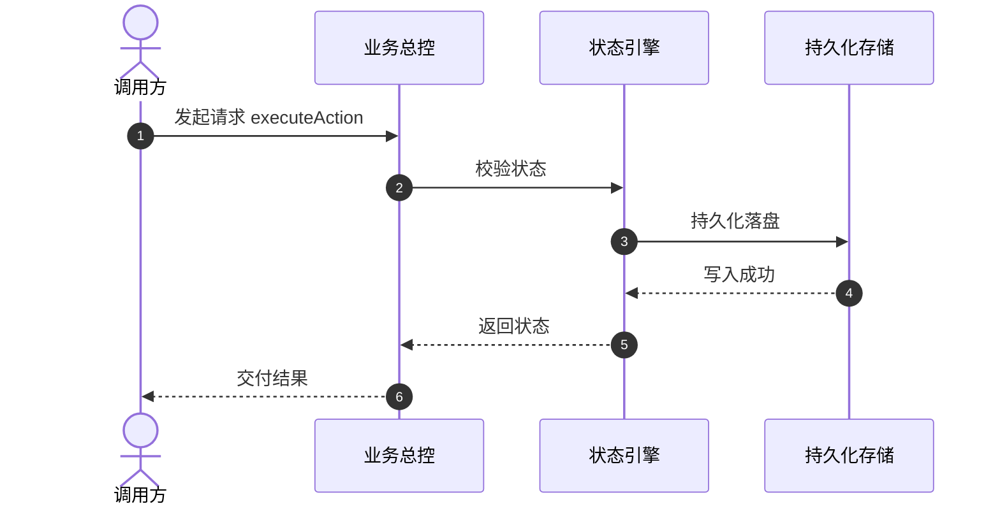

# RFC-{{RFC_ID}}: {{FEATURE_NAME}} 详细设计方案

- **作者**：{{AUTHOR}}
- **创建日期**：{{DATE}}
- **状态**：[DRAFT / IN_REVIEW / APPROVED / IMPLEMENTED]
- **关联需求/Issue**：#{{ISSUE_ID}}

---

## 1. 需求背景与目标 (Background & Goals)
### 1.1 需求背景
简要说明业务背景与为什么需要该特性。

### 1.2 预期目标 (In Scope)
- 目标 1
- 目标 2

### 1.3 明确不做的范围 (Out of Scope)
- 非本期交付内容

---

## 2. 验收用例标准 (Given-When-Then Acceptance Criteria)

### Scenario 1: 正常流程
- **Given**: 系统处于初始就绪状态
- **When**: 触发业务核心动作
- **Then**: 预期产生正确响应并持久化结果

### Scenario 2: 异常或容灾流程
- **Given**: 网络异常中断或存储受阻
- **When**: 触发业务操作
- **Then**: 优雅降级并记录结构化日志，不产生未捕获异常

---

## 3. 架构设计与接口契约 (Architecture & Protocol Design)

### 3.1 跨模块 Public Protocol 契约
```swift
// 示例契约接口定义
public protocol FeatureServiceProtocol: AnyObject {
    func executeAction(with params: FeatureParam) async throws -> FeatureResult
}
```

### 3.2 交互时序图


---

## 4. 复用嗅探与 DRY 审计 (DRY Audit)
- 检查已有公共基础库与工具类：已确认无重复实现。
- 本次提炼的通用抽象：...

---

## 5. 模块拆解与开发子任务清单 (Subtasks)
- [ ] Subtask 1: 契约接口与领域模型定义
- [ ] Subtask 2: 核心引擎状态机实现
- [ ] Subtask 3: 持久化存储与缓存层对接
- [ ] Subtask 4: 单元测试全覆盖 (含冷启动/边界恢复)
